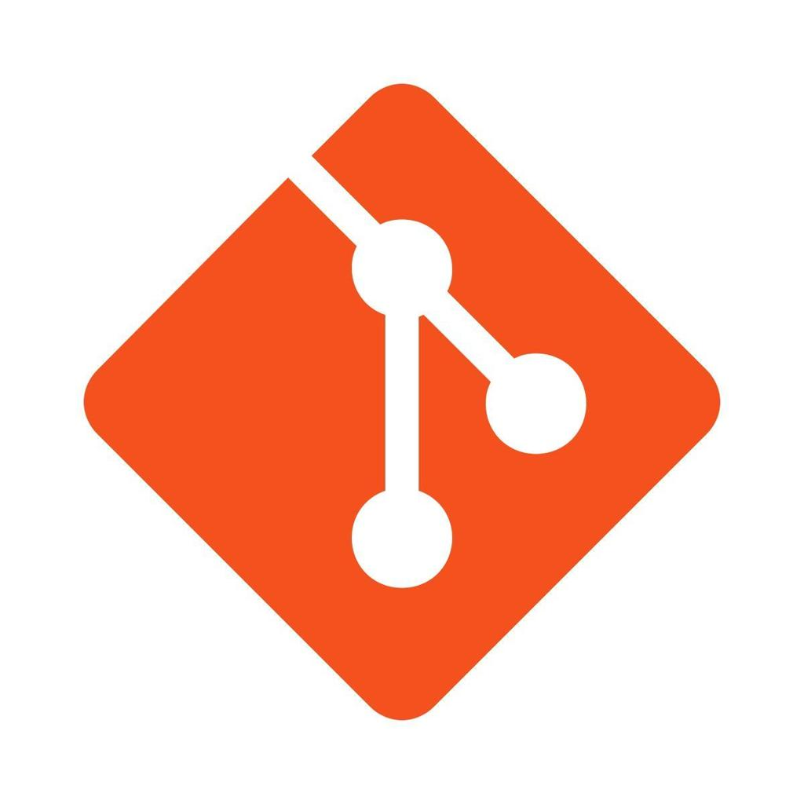
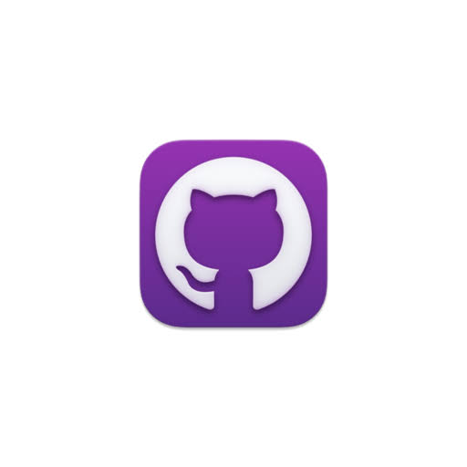
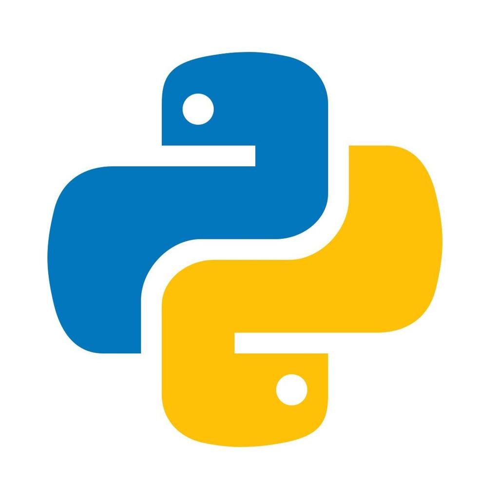
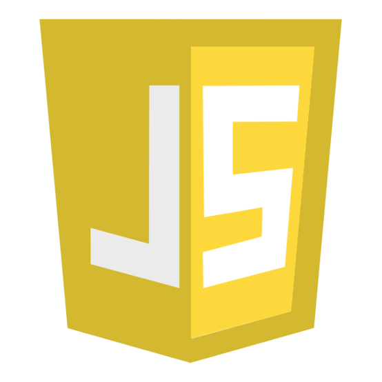

# 👋 Hi, I'm Nibha Pajiyar

A passionate developer using Windows and GitHub Desktop to build cool projects. Welcome to my GitHub profile!

---

### 💻 Tech Stack & Tools

<!-- Reliable Local Images -->

#### 🛠️ Languages

---

### 🚀 What I'm Working On
- 🔭 I’m currently building software applications on my Windows machine.
- 🌱 I’m practicing clean version control workflows using GitHub Desktop.
- 👯 I’m looking to collaborate on open-source starter projects.
